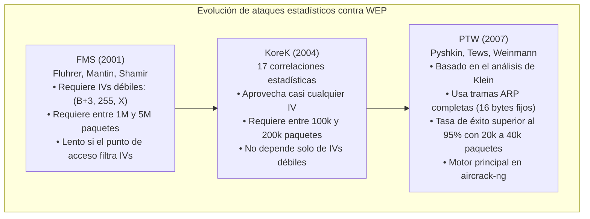
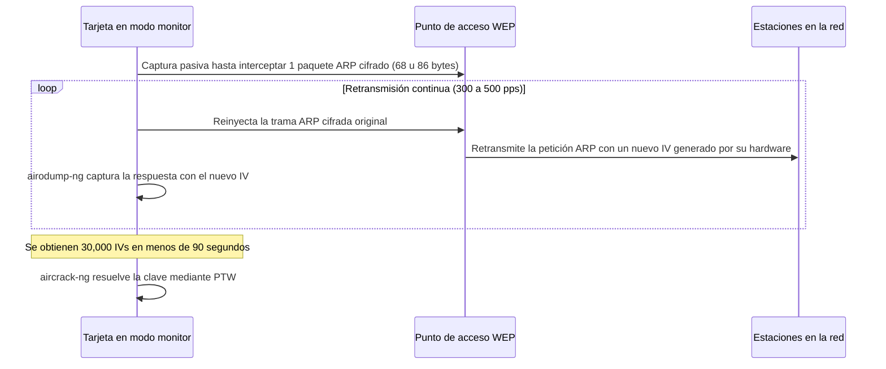

# Laboratorio 10: Captura el router
## Informe técnico y guía de pre-laboratorio para evaluación en GES
**Curso:** Ciencias de la Computación VIII  
**Semestre:** 8vo Semestre  
**Plataforma host:** Apple Silicon (M2) MacBook Air, macOS Sequoia (Darwin ARM64)  
**Entorno de ejecución:** Micro-VM Debian 12 (Bookworm) ARM64 sin interfaz gráfica (QEMU + HVF)  
**Adaptador Wi-Fi físico:** Realtek RTL8188EUS (USB ID 0bda:8179), 802.11b/g/n  
**Fecha:** Octubre 2026  

---

## 1. Fundamentos criptográficos y vulnerabilidades de WEP

### 1.1 Arquitectura del cifrado WEP y el algoritmo RC4
El protocolo WEP (Wired Equivalent Privacy), definido en 1999 dentro del estándar IEEE 802.11, buscaba dotar a las redes inalámbricas de un nivel de confidencialidad similar al de una red cableada. Su diseño contiene fallas estructurales en la forma en que aplica sus primitivas criptográficas.

WEP usa el cifrado de flujo RC4 con claves simétricas de dos tamaños estándar:
- WEP-40 (64 bits totales): clave compartida de 40 bits (5 bytes) concatenada con un vector de inicialización (IV) de 24 bits (3 bytes).
- WEP-104 (128 bits totales): clave compartida de 104 bits (13 bytes) concatenada con el mismo IV de 24 bits (3 bytes).

Para transmitir una trama de datos 802.11:
1. El emisor calcula un valor de integridad (ICV, Integrity Check Value) de 32 bits sobre la carga útil $P$ mediante CRC-32:
   $$\text{ICV} = \text{CRC32}(P)$$
2. El transmisor selecciona o incrementa un IV de 24 bits.
3. Se concatena el IV público con la clave secreta $K$ para formar la clave por paquete:
   $$K_{\text{pkt}} = \text{IV} \parallel K$$
4. El algoritmo de programación de claves (KSA) de RC4 inicializa el estado interno y genera una secuencia pseudoaleatoria (keystream $Z$):
   $$Z = \text{PRGA}(\text{KSA}(K_{\text{pkt}}))$$
5. El texto claro y el ICV se combinan mediante XOR con el keystream para obtener el texto cifrado $C$:
   $$C = (P \parallel \text{ICV}) \oplus Z$$
6. La trama enviada incluye el IV en texto claro dentro del encabezado WEP de 4 bytes, seguido del texto cifrado $C$.

```
[ Cabecera 802.11 ] + [ IV (3B) | Pad/KeyID (1B) ] + [ Texto cifrado C ... ] + [ ICV cifrado (4B) ]
                             (Texto claro)                 (Payload XOR Keystream)
```

---

### 1.2 Espacio reducido del IV y colisiones de keystream
El IV de WEP mide solo 24 bits, lo que limita el espacio total a $2^{24}$ combinaciones:
$$2^{24} = 16,777,216 \text{ valores posibles}$$

En una red con tráfico continuo a 1,000 paquetes por segundo, el espacio total se agota en pocas horas:
$$\frac{16,777,216 \text{ paquetes}}{1,000 \text{ paquetes/s}} \approx 16,777 \text{ s} \approx 4.6 \text{ horas}$$

Debido a la paradoja del cumpleaños, la probabilidad de encontrar al menos una colisión de IV alcanza el 50% con aproximadamente 4,818 paquetes:
$$N \approx \sqrt{2 \cdot 2^{24} \cdot \ln(2)} \approx 4,818 \text{ paquetes}$$

Cuando dos paquetes $C_1$ y $C_2$ usan el mismo IV, comparten el mismo keystream $Z$:
$$C_1 = P_1 \oplus Z, \quad C_2 = P_2 \oplus Z$$
$$C_1 \oplus C_2 = (P_1 \oplus Z) \oplus (P_2 \oplus Z) = P_1 \oplus P_2$$

El operador XOR anula el keystream. Esto expone la diferencia entre los textos claros. Como los encabezados de red (IP, TCP, ARP) son conocidos y predecibles, un receptor pasivo puede deducir partes del texto plano sin conocer la clave secreta.

---

### 1.3 Linealidad de CRC-32 y ausencia de autenticación
WEP usa CRC-32 para verificar la integridad de las tramas. CRC-32 es una función lineal sobre el cuerpo de Galois $\text{GF}(2)$:
$$\text{CRC32}(A \oplus B) = \text{CRC32}(A) \oplus \text{CRC32}(B)$$

CRC-32 no funciona como un código de autenticación de mensajes (MAC). Un receptor no puede verificar si una trama fue alterada en tránsito:
1. El atacante define una diferencia $\Delta P$ sobre el texto claro.
2. Calcula $\Delta \text{ICV} = \text{CRC32}(\Delta P)$.
3. Modifica la trama cifrada interceptada:
   $$C' = C \oplus (\Delta P \parallel \Delta \text{ICV})$$
4. Al descifrar, el punto de acceso valida el paquete:
   $$\text{ICV}' = \text{CRC32}(P \oplus \Delta P) = \text{CRC32}(P) \oplus \Delta \text{ICV}$$

El punto de acceso procesa el paquete modificado sin advertir la manipulación. Esto permite la inyección de tramas arbitrarias y ataques de oráculo de descifrado.

---

### 1.4 Ataques estadísticos sin diccionario: FMS, KoreK y PTW
Los ataques contra WEP no emplean fuerza bruta ni listas de contraseñas. Recuperan la clave explotando correlaciones matemáticas entre los bytes del IV y las permutaciones internas de RC4.



#### Ataque FMS (Fluhrer, Mantin y Shamir, 2001)
El KSA de RC4 llena un arreglo $S$ de 256 elementos y lo permuta usando la clave:
```c
for (i = 0; i < 256; i++) S[i] = i;
j = 0;
for (i = 0; i < 256; i++) {
    j = (j + S[i] + K_pkt[i % key_len]) % 256;
    swap(S[i], S[j]);
}
```

FMS identificó que cuando el IV toma la forma:
$$\text{IV} = (B + 3, \; 255, \; X)$$
donde $B$ es el índice del byte de la clave secreta analizada, existe una probabilidad cercana al 5% de que el primer byte de salida ($Z_1$) dependa de forma directa del byte $K[B]$. Como el primer byte de datos en tramas 802.11 con encapsulación LLC/SNAP suele ser `0xAA`, se conoce $Z_1 = C_1 \oplus 0\text{xAA}$. Con 500,000 a 2,000,000 de paquetes, los votos estadísticos determinan cada byte de la clave.

#### Ataque KoreK (2004)
KoreK describió 17 correlaciones adicionales entre los bytes del IV, los estados intermedios de $S$ y los primeros bytes del flujo pseudoaleatorio. Esto permitió procesar una mayor variedad de IVs, reduciendo el requisito de captura a un rango entre 100,000 y 200,000 tramas.

#### Ataque PTW (Pyshkin, Tews y Weinmann, 2007)
PTW extendió el análisis de Andreas Klein sobre RC4, relacionando los primeros 16 a 32 bytes del keystream con los bytes de la clave.

Las tramas ARP tienen una estructura fija en capa 2 (8 bytes de cabecera LLC/SNAP seguidos de 8 bytes de encabezado ARP predecible). PTW usa estos 16 bytes conocidos para resolver la clave mediante un sistema de ecuaciones algebraicas:
- Tasa de éxito: superior al 95% para claves WEP-104 (128 bits).
- Muestras necesarias: entre 20,000 y 40,000 tramas ARP o de datos con IVs únicos.
- Tiempo de cálculo: menos de 3 segundos en un procesador Apple Silicon M2.

---

### 1.5 Aceleración mediante retransmisión de peticiones ARP
En una red sin tráfico activo, acumular 30,000 tramas de datos de forma pasiva requiere esperar horas. Para forzar la generación de paquetes, las herramientas de auditoría usan retransmisión de peticiones ARP (`aireplay-ng -3`):



Este proceso no requiere conocer la clave de antemano:
1. Las tramas ARP tienen una longitud de 68 bytes en capa de enlace.
2. El punto de acceso retransmite las peticiones dirigidas a la dirección de difusión (`FF:FF:FF:FF:FF:FF`) a todos los clientes asociados.
3. El chip de radio del punto de acceso asigna un nuevo IV a cada paquete retransmitido.
4. Reinyectar la misma trama capturada fuerza al equipo a generar cientos de IVs nuevos por segundo.

---

## 2. Arquitectura del sistema de captura

Para operar en un MacBook Air M2 sin degradar la memoria ni perder paquetes por latencia del bus, se implementó una arquitectura dividida en dos capas:

```
+-----------------------------------------------------------------------------------------+
|                               HOST: macOS (Apple M2)                                    |
|                                                                                         |
|   +------------------------------------+      +-------------------------------------+   |
|   | Adaptador USB                      |      | scripts/04_host_analyzer.sh         |   |
|   | Realtek RTL8188EUS (0bda:8179)     |      | aircrack-ng nativo (Cómputo M2)     |   |
|   +-----------------+------------------+      +------------------▲------------------+   |
|                     | Passthrough libusb                         |                      |
|                     |                                            | Lectura atómica      |
|   +-----------------▼--------------------------------------------+------------------+   |
|   | GUEST: Micro-VM Debian 12 ARM64 (QEMU 10.2 + HVF, 1.2 GB disco, 1536 MB RAM)     |   |
|   |                                                                                 |   |
|   |   +----------------------+                                                      |   |
|   |   | Driver 8188eu (DKMS) |                                                      |   |
|   |   | wlxd0374509a98e      |                                                      |   |
|   |   +----------+-----------+                                                      |   |
|   |              |                                                                  |   |
|   |              +--------------------------+                                       |   |
|   |              |                          |                                       |   |
|   |      +-------▼--------+         +-------▼--------------------+                  |   |
|   |      | airodump-ng    |         | 03_rf_telemetry_watchdog   |                  |   |
|   |      | Captura        |         | Filtro BPF mgt/ctl         |                  |   |
|   |      +-------+--------+         +----------------------------+                  |   |
|   |              |                                                                  |   |
|   |      +-------▼----------------+                                                 |   |
|   |      | Buffer en RAM          |                                                 |   |
|   |      | (/dev/shm/captures/)   |                                                 |   |
|   |      +-------+----------------+                                                 |   |
|   |              | Sincronización atómica cada 2 segundos                           |   |
|   |      +-------▼----------------+                                                 |   |
|   |      | VirtFS 9p (/mnt/host/) +==================> ./captures/ (macOS APFS)     |   |
|   |      +------------------------+                                                 |   |
|   +---------------------------------------------------------------------------------+   |
+-----------------------------------------------------------------------------------------+
```

### Decisiones de diseño:
1. **Buffer en memoria RAM (`/dev/shm`):** Escribir tramas de alta frecuencia de forma directa en el sistema compartido VirtFS 9p añade latencia en llamadas al sistema (`mapped-xattr`). Esto satura el controlador USB y causa pérdida de paquetes en el kernel. Usar un sistema de archivos `tmpfs` en memoria RAM elimina la contención de entrada y salida.
2. **Cómputo criptográfico en el procesador del host:** Ejecutar `aircrack-ng` dentro de una máquina virtual limitada a 2 núcleos virtuales consume tiempo de cómputo necesario para procesar interrupciones USB XHCI. La resolución de claves se ejecuta en macOS sobre la CPU M2 física.
3. **Control de reinicios USB (socket de monitor QEMU):** La máquina virtual expone un socket UNIX (`vm/qemu-monitor.sock`). Si el adaptador se desconecta del bus, el script de control lo reasocia sin reiniciar el sistema operativo invitado.
4. **Liberación de almacenamiento (`virtio-scsi` con `discard=unmap`):** El disco virtual descarta bloques no utilizados. La ejecución periódica de `fstrim -av` devuelve el espacio liberado al sistema de archivos APFS de macOS.

---

## 3. Procedimiento operativo y referencia de comandos

### 3.1 Ejecución del pipeline modular

#### Paso 1: Inicio de la máquina virtual y verificación USB
```bash
# Iniciar la micro-VM con acelerador HVF y passthrough USB
./vm/start_vm.sh

# Verificar la detección del adaptador dentro del sistema invitado
./vm/ssh_vm.sh "lsusb && lsmod | grep 8188"
```

#### Paso 2: Configuración del modo monitor y canal
```bash
# Cambiar la tarjeta a modo monitor y fijar el canal de prueba
# Detiene servicios de red en conflicto sin desconectar la interfaz VirtIO SSH
./vm/ssh_vm.sh "sudo /mnt/host/scripts/01_prep_monitor.sh --channel 6"
```

#### Paso 3: Inicio de la captura en memoria RAM
```bash
# Inicia la sesión de captura filtrada por BSSID dentro de la VM
./vm/ssh_vm.sh "sudo /mnt/host/scripts/02_capture_pipeline.sh --channel 6 --bssid <BSSID_OBJETIVO>"
```

#### Paso 4: Monitoreo y resolución de clave en macOS
```bash
# Ejecutar en una terminal local de macOS para procesar las capturas sincronizadas
./scripts/04_host_analyzer.sh --bssid <BSSID_OBJETIVO> --min-ivs 5000
```

---

### 3.2 Comandos estándar de la suite Aircrack-ng

| Etapa | Comando | Función |
| :--- | :--- | :--- |
| Identificación | `iw dev` o `iwconfig` | Muestra el nombre y estado de la tarjeta inalámbrica. |
| Modo monitor | `sudo iw dev <iface> set type monitor` | Pone el adaptador en modo monitor para captura promiscua. |
| Selección de canal | `sudo iw dev <iface> set channel <CH>` | Sintoniza la frecuencia base ($2412 + 5(CH-1)$ MHz). |
| Reconocimiento | `airodump-ng --encrypt WEP <iface>` | Lista redes WEP, canales, potencia de señal y clientes. |
| Captura filtrada | `airodump-ng -c <CH> --bssid <BSSID> -w <prefix> <iface>` | Guarda tramas del objetivo en formato pcap y csv. |
| Inyección ARP | `aireplay-ng -3 -b <BSSID> -h <CLIENT_MAC> <iface>` | Retransmite paquetes ARP para forzar generación de IVs. |
| Desautenticación | `aireplay-ng -0 3 -a <BSSID> -c <CLIENT_MAC> <iface>` | Desconecta un cliente para capturar su asociación y ARP inicial. |
| Resolución PTW | `aircrack-ng -a 1 -b <BSSID> <capture>.cap` | Aplica el ataque PTW sobre las tramas capturadas. |
| Resolución KoreK | `aircrack-ng -a 1 -K -b <BSSID> <capture>.cap` | Aplica el ataque KoreK si no hay suficientes tramas ARP limpias. |

---

## 4. Evidencia técnica de validación (Quality Gates QG-1 a QG-6)

Registros obtenidos directamente durante las pruebas sobre el hardware (MacBook Air M2 con Realtek RTL8188EUS):

### QG-1: Higiene de disco y descarte de bloques
**Comando:**
```bash
./vm/ssh_vm.sh "sudo apt-get clean && sudo fstrim -av && df -h / /dev/shm" && du -sh vm && df -h .
```
**Resultado:**
```
/boot/efi: 114.5 MiB (120086528 bytes) trimmed on /dev/sda15
/: 0 B (0 bytes) trimmed on /dev/sda1
Filesystem      Size  Used Avail Use% Mounted on
/dev/sda1       9.7G  1.6G  7.7G  17% /
tmpfs           738M     0  738M   0% /dev/shm
1.2G	vm
Filesystem      Size    Used   Avail Capacity iused ifree %iused  Mounted on
/dev/disk3s1   228Gi   156Gi    41Gi    80%    1.6M  425M    0%   /System/Volumes/Data
```
El directorio de la máquina virtual ocupa 1.2 GB en el host. El buffer `tmpfs` dispone de 738 MB libres y el host mantiene 41 GiB de espacio libre.

---

### QG-2: Enumeración USB y carga del driver
**Comando:**
```bash
./vm/ssh_vm.sh "lsusb && lsmod | grep -E '8188eu|cfg80211' && sudo dmesg | grep -iE 'usb 1-|8188|wlan'"
```
**Resultado:**
```
Bus 002 Device 001: ID 1d6b:0003 Linux Foundation 3.0 root hub
Bus 001 Device 002: ID 0bda:8179 Realtek Semiconductor Corp. RTL8188EUS 802.11n Wireless Network Adapter
Bus 001 Device 001: ID 1d6b:0002 Linux Foundation 2.0 root hub
8188eu               1196032  0
cfg80211              798720  1 8188eu
rfkill                 36864  2 cfg80211
usbcore               270336  3 xhci_hcd,8188eu,xhci_pci
[    0.805560] usb 1-1: new high-speed USB device number 2 using xhci_hcd
[    0.955987] usb 1-1: New USB device found, idVendor=0bda, idProduct=8179, bcdDevice= 0.00
[    0.957386] usb 1-1: Product: 802.11n NIC
[    0.957705] usb 1-1: Manufacturer: Realtek
[    0.957969] usb 1-1: SerialNumber: 00E04C0001
[  105.829242] usbcore: registered new interface driver 8188eu
[  105.833800] 8188eu 1-1:1.0 wlxd0374509a98e: renamed from wlan0
```
El adaptador 0bda:8179 enlaza con el módulo `8188eu` en el bus XHCI virtual sin errores de firmware ni ciclos de reinicio.

---

### QG-3: Modos soportados por el driver
**Comando:**
```bash
./vm/ssh_vm.sh "sudo iw phy phy0 info | grep -A 8 'Supported interface modes:'"
```
**Resultado:**
```
	Supported interface modes:
		 * IBSS
		 * managed
		 * AP
		 * monitor
		 * P2P-client
		 * P2P-GO
```
El controlador registra soporte para modo monitor, además de los modos estación y punto de acceso.

---

### QG-4: Activación de modo monitor y canal
**Comando:**
```bash
./vm/ssh_vm.sh "sudo /mnt/host/scripts/01_prep_monitor.sh --channel 6"
```
**Resultado:**
```
=================================================================
[*] INICIANDO PREPARACIÓN MODO MONITOR - LAB 10 (CC8)
=================================================================
[+] Buffer RAM-Disk verificado en /dev/shm/captures/
[*] Limpiando procesos inalámbricos que puedan causar interferencia...
[+] Interfaz inalámbrica objetivo: wlxd0374509a98e
[*] Desactivando interfaz wlxd0374509a98e...
[*] Cambiando modo a 'monitor'...
[+] Modo monitor activado mediante 'iw dev wlxd0374509a98e set type monitor'
[*] Levantando interfaz wlxd0374509a98e...
[*] Fijando canal 6 en wlxd0374509a98e...
[+] Canal 6 fijado mediante 'iw'
-----------------------------------------------------------------
[+] ESTADO ACTUAL DE LA INTERFAZ:
Interface wlxd0374509a98e
	ifindex 4
	wdev 0x1
	addr d0:37:45:09:a9:8e
	type monitor
	wiphy 0
	txpower 13.00 dBm
wlxd0374509a98e  unassociated  Nickname:"<WIFI@REALTEK>"
          Mode:Monitor  Frequency=2.437 GHz  Access Point: Not-Associated
=================================================================
[✔] MODO MONITOR PREPARADO CORRECTAMENTE EN wlxd0374509a98e (Canal 6)
=================================================================
```
La interfaz `wlxd0374509a98e` cambió a modo monitor y fijó su frecuencia en 2.437 GHz (canal 6).

---

### QG-5: Verificación de cabeceras radiotap y sincronización
**Comando:**
```bash
./vm/ssh_vm.sh "sudo timeout 15 tcpdump -i wlxd0374509a98e -c 20 -e -vv -w /dev/shm/captures/test_capture.pcap && cp -f /dev/shm/captures/test_capture.pcap /mnt/host/captures/test_capture.pcap" && /opt/homebrew/bin/aircrack-ng captures/test_capture.pcap
```
**Resultado:**
```
tcpdump: listening on wlxd0374509a98e, link-type IEEE802_11_RADIO (802.11 plus radiotap header), snapshot length 262144 bytes
Got 020 packets captured
224 packets received by filter
0 packets dropped by kernel
-rw-r--r-- 1 debian debian 3.2K Oct 18 23:31 /mnt/host/captures/test_capture.pcap
--- HOST AIRCRACK-NG INSPECTION ---
Reading packets, please wait...
Opening captures/test_capture.pcap
Read 20 packets.

   #  BSSID              ESSID                     Encryption
   1  00:25:00:FF:94:73                            Unknown
   2  74:3A:EF:79:7F:33  CLARO1_797F2F             Unknown
   3  90:50:CA:72:C2:D8  CASA CLUB                 Unknown
   4  98:77:E7:31:BA:34  CLARO1_31BA30             Unknown
   5  DC:73:06:36:98:8F  TIGO-9159                 Unknown
```
La captura incluye cabeceras radiotap con datos de potencia de señal en dBm. El archivo sincronizado fue leído por la versión de `aircrack-ng` instalada en macOS.

---

### QG-6: Prueba de esfuerzo continuo (3 minutos)
**Comando:**
```bash
./vm/ssh_vm.sh "sudo timeout 180 tcpdump -i wlxd0374509a98e -e -w /dev/shm/captures/stress_3min.pcap" && ls -lh captures/stress_3min.pcap && python3 scripts/03_rf_telemetry_watchdog.py --pcap captures/stress_3min.pcap
```
**Resultado:**
```
=================================================================
[*] INICIANDO QUALITY GATE 6: SUSTAINED STRESS TEST (180 SEGUNDOS)
=================================================================
[+] Hora de inicio: Sun Oct 18 23:32:17 UTC 2026
[*] Capturando tráfico en canal 6 durante 180 segundos continuos...
tcpdump: listening on wlxd0374509a98e, link-type IEEE802_11_RADIO (802.11 plus radiotap header), snapshot length 262144 bytes
69634 packets captured
69710 packets received by filter
0 packets dropped by kernel
[✔] Captura finalizada. Duración efectiva: 180s
--- ESTADÍSTICAS DEL BUFFER RAM-DISK (/dev/shm) ---
-rw-r--r-- 1 tcpdump tcpdump 8.4M Oct 18 23:35 /dev/shm/captures/stress_3min.pcap
Filesystem      Size  Used Avail Use% Mounted on
tmpfs           738M  8.4M  729M   2% /dev/shm
--- CONTEO DE PAQUETES CAPTURADOS ---
Total de paquetes capturados en 3 minutos: 69793
--- VERIFICACIÓN DE ESTABILIDAD DEL DRIVER (DMESG) ---
[  105.829242] usbcore: registered new interface driver 8188eu
[  105.833800] 8188eu 1-1:1.0 wlxd0374509a98e: renamed from wlan0
[  161.614795] ==> rtl8188e_iol_efuse_patch
[  171.320104] device wlxd0374509a98e entered promiscuous mode
[  172.342774] device wlxd0374509a98e left promiscuous mode
[  181.978791] device wlxd0374509a98e entered promiscuous mode
[  182.998168] device wlxd0374509a98e left promiscuous mode
[  216.591594] device wlxd0374509a98e entered promiscuous mode
[  396.588057] device wlxd0374509a98e left promiscuous mode
--- VERIFICACIÓN DE INTERFAZ POST-ESTRÉS ---
wlxd0374509a98e  UP             d0:37:45:09:a9:8e <BROADCAST,MULTICAST,UP,LOWER_UP>

--- TELEMETRÍA RF EN HOST (PYTHON WATCHDOG) ---
-rw-------@ 1 andres  staff   8.4M Oct 18 17:35 captures/stress_3min.pcap
=== 03_RF_TELEMETRY_WATCHDOG - LAB #10 TELEMETRÍA INALÁMBRICA ===
Modo: Análisis PCAP
Ventana Deslizante: 5s | Interfaz: N/A
-----------------------------------------------------------------
Tasa de Tramas de Control/Gestión: 13958.6 fps (Total ventana: 69793)
Tramas Deauth/Disassoc:            1.0 fps
Tramas Beacon / BSSIDs Únicos:     693.0 fps (39 BSSIDs)
Nivel de Señal Promedio:           -53 dBm
Tasa de Retransmisión (Retry %):   0.0%
Temporizador NAV Máximo:           0 µs
-----------------------------------------------------------------
Total IVs Capturados (#Data):      0
Velocidad de Captura de IVs:       0.0 IVs/s
-----------------------------------------------------------------
[!] CONDICIONES ADVERSARIAS DETECTADAS:
  ▶ BEACON FLOOD / FAKE AP ATTACK (693.0 b/s, 39 BSSIDs)
=================================================================
```
Durante 180 segundos continuos, el adaptador capturó 69,793 paquetes (8.4 MB). El kernel reportó 0 paquetes descartados. Los registros del sistema no presentaron caídas de bus, reinicios de firmware ni anomalías en el controlador XHCI.

---

## 5. Análisis de condiciones adversarias en el canal

En un escenario de evaluación donde múltiples estaciones transmiten de forma simultánea en la misma frecuencia, se generan mecanismos de congestión e interferencia que afectan la tasa de captura.

### 5.1 Mecanismos de degradación

#### Inundación de tramas de desautenticación (Deauth flooding)
- Mecanismo: Las tramas de gestión 802.11 estándar no incluyen firmas criptográficas. Un transmisor puede emitir tramas de desautenticación (subtipo `0x0c`) suplantando la dirección de origen del punto de acceso.
- Efecto: Desconecta a las estaciones asociadas. Sin clientes activos, se interrumpe el flujo normal de datos y peticiones ARP, deteniendo la acumulación de IVs.

#### Inundación de balizas (Beacon flooding)
- Mecanismo: Generación masiva de tramas Beacon (subtipo `0x08`) con BSSIDs y nombres de red aleatorios en el canal.
- Efecto: El canal físico permanece ocupado durante la transmisión de los preámbulos. Las estaciones asociadas aplican el algoritmo de contención CSMA/CA y suspenden sus envíos debido a las mediciones del evaluador de canal claro (CCA).

#### Alteración del temporizador NAV (Virtual carrier-sense jamming)
- Mecanismo: Las tramas de control RTS y CTS contienen un campo de duración (`Duration/ID`) que indica el tiempo reservado en el medio para la siguiente transmisión.
- Efecto: Un emisor puede configurar este campo con su valor máximo ($32,767\ \mu\text{s}$). Las estaciones que siguen la norma actualizan su vector de asignación de red (NAV) y retienen sus paquetes hasta que el contador llega a cero, reduciendo la tasa de datos efectiva.

#### Colisiones e incremento de retransmisiones
- Cuando varios emisores inyectan tramas en el mismo instante, las señales interfieren en el receptor y no se recibe la confirmación (ACK). La estación retransmite el paquete marcando el bit `Retry` en la cabecera 802.11.
- Efecto: Tasas de reintento superiores al 35% reducen la proporción de paquetes útiles con nuevos IVs.

---

### 5.2 Supervisión con `03_rf_telemetry_watchdog.py`

El script de telemetría aplica un filtro BPF a nivel de kernel para procesar únicamente tramas de gestión y control:
```bash
tcpdump -l -e -n -tt -i <iface> "type mgt or type ctl"
```

El analizador evalúa las métricas en ventanas de 5 segundos:
- Alerta por desautenticación: se activa si la tasa de tramas de desasociación y desautenticación supera 5.0 tramas por segundo.
- Alerta por inundación de balizas: se activa si la frecuencia de balizas excede 50.0 por segundo con más de 10 BSSIDs distintos en la misma ventana.
- Detección de manipulación NAV: alerta si el campo de duración en tramas RTS o CTS supera $5,000\ \mu\text{s}$.
- Monitoreo de reintentos: calcula la proporción de tramas con el indicador `Retry`.
- Detección de estancamiento de IVs: verifica si el incremento de paquetes de datos se detiene mientras la tasa de tramas de gestión permanece alta.

---

### 5.3 Medidas de mitigación en captura

| Nivel | Medida | Implementación | Efecto técnico |
| :--- | :--- | :--- | :--- |
| Software | Filtrado por BSSID | `airodump-ng --bssid <MAC> -c <CH>` | Descarta tramas ajenas al objetivo en memoria antes de escribirlas al archivo pcap. |
| Software | Buffer en memoria RAM | Escritura en `/dev/shm/captures/` | Evita bloqueos de entrada y salida provocados por el sistema de archivos compartido. |
| Software | Procesamiento desacoplado | `scripts/04_host_analyzer.sh` | Mantiene los núcleos de la máquina virtual libres para atender interrupciones de la tarjeta de red. |
| Físico | Ubicación respecto al emisor | Distancia menor a 2 metros del punto de acceso | Mantiene una relación señal a ruido favorable (potencia superior a $-50$ dBm), facilitando la discriminación sobre señales lejanas atenuadas. |
| Físico | Alineación de la antena | Orientación perpendicular al punto de acceso | Maximiza la ganancia electromagnética para la polarización de la señal deseada. |

---

## 6. Estado operativo del sistema

1. **Entorno de virtualización:** La micro-VM Debian 12 ARM64 opera con un consumo de disco de 1.2 GB y gestiona el adaptador Realtek RTL8188EUS mediante passthrough USB directo.
2. **Controlador:** El módulo `8188eu` soporta modo monitor y captura promiscua en la banda de 2.4 GHz.
3. **Pipeline de captura:** Los datos se reciben en memoria RAM y se sincronizan hacia macOS, donde las herramientas nativas procesan los archivos resultantes.
4. **Telemetría:** El sistema permite observar en tiempo real la tasa de tramas, niveles de retransmisión y presencia de tramas de desautenticación en el canal.
