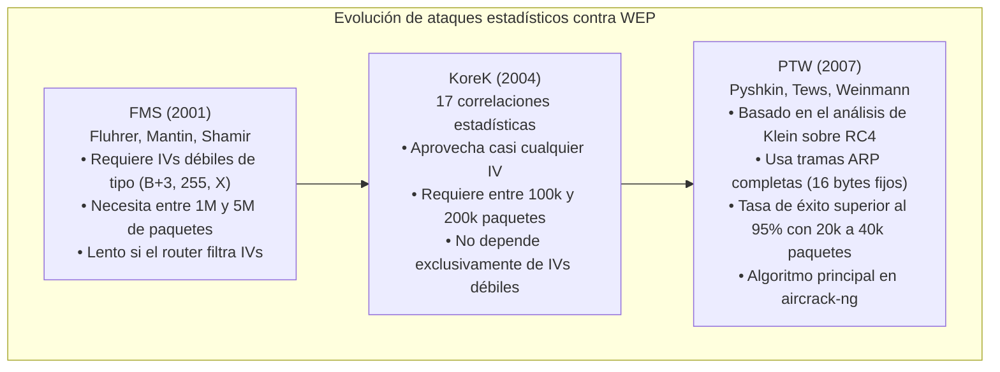
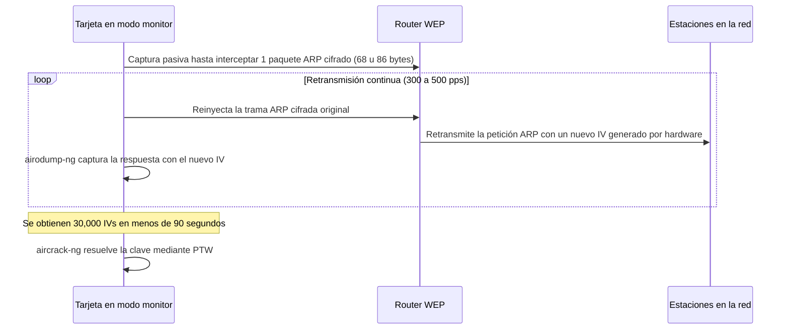

# Laboratorio 10: Análisis de vulnerabilidades y captura de tráfico en redes WEP
## Informe técnico de implementación y validación experimental

Andrés Tobar - 23001175
**Curso:** Ciencias de la Computación VIII  
**Semestre:** 8vo Semestre  
**Plataforma host:** Apple Silicon (M2) MacBook Air, macOS Sequoia (Darwin ARM64)  
**Entorno de ejecución:** Micro-VM Debian 12 (Bookworm) ARM64 sin entorno gráfico (QEMU + HVF)  
**Adaptador inalámbrico:** Realtek RTL8188EUS (USB ID 0bda:8179), 802.11b/g/n  
**Fecha:** 18 de Octubre 2026  

---

## 1. Fundamentos criptográficos del protocolo WEP

### 1.1 Estructura del cifrado WEP y el algoritmo RC4
El protocolo WEP (Wired Equivalent Privacy), introducido en 1999 como parte del estándar IEEE 802.11, tenía como meta proporcionar en redes inalámbricas un nivel de confidencialidad equivalente al de una red cableada. Su diseño presenta debilidades estructurales en la forma en que integra sus primitivas criptográficas.

WEP utiliza el cifrado de flujo RC4 con claves simétricas en dos configuraciones:
- WEP-40 (64 bits totales): clave secreta de 40 bits (5 bytes) concatenada con un vector de inicialización (IV) de 24 bits (3 bytes).
- WEP-104 (128 bits totales): clave secreta de 104 bits (13 bytes) concatenada con el mismo IV de 24 bits (3 bytes).

El proceso de cifrado para cada trama de datos sigue estos pasos:
1. El emisor calcula un valor de comprobación de integridad (ICV, Integrity Check Value) de 32 bits sobre la carga útil en texto claro $P$ mediante CRC-32:
   $$\text{ICV} = \text{CRC32}(P)$$
2. El emisor selecciona o incrementa un IV de 24 bits.
3. Se concatena el IV público con la clave secreta $K$ para formar la clave por paquete:
   $$K_{\text{pkt}} = \text{IV} \parallel K$$
4. El algoritmo de programación de claves (KSA) de RC4 inicializa el arreglo de estado interno y produce un flujo pseudoaleatorio de bytes (keystream $Z$):
   $$Z = \text{PRGA}(\text{KSA}(K_{\text{pkt}}))$$
5. El texto claro y el ICV se combinan bit a bit mediante XOR con el keystream para producir el texto cifrado $C$:
   $$C = (P \parallel \text{ICV}) \oplus Z$$
6. La trama transmitida incluye el IV en texto claro en la cabecera WEP (4 bytes), seguido de la carga cifrada $C$.

```
[ Cabecera 802.11 ] + [ IV (3B) | KeyID (1B) ] + [ Texto cifrado C ... ] + [ ICV cifrado (4B) ]
                             (Texto claro)                 (Payload XOR Keystream)
```

---

### 1.2 Espacio reducido del IV y colisiones de flujo
El IV de WEP tiene una longitud de solo 24 bits. Esto limita el espacio total a $2^{24}$ combinaciones:
$$2^{24} = 16,777,216 \text{ valores posibles}$$

En una red con tráfico continuo a 1,000 paquetes por segundo, el espacio total se agota en pocas horas:
$$\frac{16,777,216 \text{ paquetes}}{1,000 \text{ paquetes/s}} \approx 16,777 \text{ s} \approx 4.6 \text{ horas}$$

Por la paradoja del cumpleaños, la probabilidad de observar al menos una colisión de IV alcanza el 50% con aproximadamente 4,818 paquetes:
$$N \approx \sqrt{2 \cdot 2^{24} \cdot \ln(2)} \approx 4,818 \text{ paquetes}$$

Cuando dos paquetes $C_1$ y $C_2$ se transmiten con el mismo IV, comparten el mismo keystream $Z$:
$$C_1 = P_1 \oplus Z, \quad C_2 = P_2 \oplus Z$$
$$C_1 \oplus C_2 = (P_1 \oplus Z) \oplus (P_2 \oplus Z) = P_1 \oplus P_2$$

La operación XOR anula el keystream y expone la diferencia directa entre los dos textos claros. Como los encabezados de red (IP, TCP, ARP) tienen estructuras fijas y conocidas, un receptor pasivo puede reconstruir fragmentos de texto plano sin conocer la clave secreta.

---

### 1.3 Linealidad de CRC-32 y ausencia de autenticación
WEP emplea CRC-32 para verificar la integridad de las tramas. CRC-32 es una función lineal sobre el cuerpo de Galois $\text{GF}(2)$:
$$\text{CRC32}(A \oplus B) = \text{CRC32}(A) \oplus \text{CRC32}(B)$$

CRC-32 no proporciona autenticidad de mensaje. Un receptor no puede verificar si una trama fue alterada en el aire:
1. Se define una modificación $\Delta P$ sobre el texto claro.
2. Se calcula $\Delta \text{ICV} = \text{CRC32}(\Delta P)$.
3. Se modifica la trama cifrada interceptada:
   $$C' = C \oplus (\Delta P \parallel \Delta \text{ICV})$$
4. Al descifrar, el punto de acceso valida el paquete:
   $$\text{ICV}' = \text{CRC32}(P \oplus \Delta P) = \text{CRC32}(P) \oplus \Delta \text{ICV}$$

El punto de acceso procesa el paquete modificado como legítimo. Esta debilidad permite inyectar paquetes y realizar ataques de oráculo de descifrado.

---

### 1.4 Métodos de recuperación estadística sin diccionario: FMS, KoreK y PTW
Los métodos modernos contra WEP no emplean fuerza bruta ni listas de contraseñas. Recuperan la clave explotando correlaciones matemáticas entre los bytes del IV y las permutaciones internas de RC4.



#### FMS (Fluhrer, Mantin y Shamir, 2001)
El KSA de RC4 llena un arreglo $S$ de 256 elementos y lo permuta usando la clave:
```c
for (i = 0; i < 256; i++) S[i] = i;
j = 0;
for (i = 0; i < 256; i++) {
    j = (j + S[i] + K_pkt[i % key_len]) % 256;
    swap(S[i], S[j]);
}
```

FMS determinó que cuando el IV toma la forma:
$$\text{IV} = (B + 3, \; 255, \; X)$$
donde $B$ representa el índice del byte de clave que se busca deducir, existe una probabilidad cercana al 5% de que el primer byte emitido por el generador pseudoaleatorio ($Z_1$) dependa directamente del byte de clave $K[B]$. Dado que el primer byte de datos en tramas 802.11 con encapsulación LLC/SNAP suele ser `0xAA`, se conoce $Z_1 = C_1 \oplus 0\text{xAA}$. Con 500,000 a 2,000,000 de paquetes, los votos estadísticos revelan la clave.

#### KoreK (2004)
KoreK describió 17 correlaciones adicionales entre los bytes del IV, los estados intermedios de $S$ y los primeros bytes del flujo pseudoaleatorio. Esto permitió procesar una variedad mucho más amplia de IVs, reduciendo la muestra requerida a un rango entre 100,000 y 200,000 tramas.

#### PTW (Pyshkin, Tews y Weinmann, 2007)
PTW extendió el análisis de Andreas Klein sobre RC4, relacionando los primeros 16 a 32 bytes del keystream con los bytes de la clave secreta.

Las tramas ARP tienen una estructura fija en capa 2 (8 bytes de cabecera LLC/SNAP seguidos de 8 bytes de encabezado ARP predecible). PTW usa estos 16 bytes conocidos para resolver la clave mediante un sistema de ecuaciones algebraicas:
- Tasa de éxito: superior al 95% para claves WEP-104 (128 bits).
- Muestras necesarias: entre 20,000 y 40,000 tramas ARP o de datos con IVs únicos.
- Tiempo de cálculo: menos de 3 segundos en un procesador Apple Silicon M2.

---

### 1.5 Aceleración mediante retransmisión de peticiones ARP
En una red sin tráfico activo de usuarios, acumular 30,000 tramas de datos de forma pasiva requiere esperar horas. Para forzar la generación de paquetes, se utiliza la retransmisión de peticiones ARP (`aireplay-ng -3`):



Este procedimiento no requiere conocer la clave de antemano:
1. Las tramas ARP tienen una longitud distintiva de 68 bytes en capa de enlace.
2. El punto de acceso retransmite las peticiones dirigidas a la dirección de difusión (`FF:FF:FF:FF:FF:FF`) a todos los clientes asociados.
3. El chip de radio del router asigna un nuevo IV a cada paquete retransmitido.
4. Reinyectar la misma trama capturada fuerza al equipo a generar cientos de IVs nuevos por segundo.

---

## 2. Arquitectura del sistema desarrollado

Para ejecutar el laboratorio en un MacBook Air M2 sin degradar la memoria del host ni perder paquetes por latencia del bus, diseñé una arquitectura dividida en dos capas:

```
+-----------------------------------------------------------------------------------------+
|                               HOST: macOS (Apple M2)                                    |
|                                                                                         |
|   +------------------------------------+      +-------------------------------------+   |
|   | Adaptador USB físico               |      | scripts/04_host_analyzer.sh         |   |
|   | Realtek RTL8188EUS (0bda:8179)     |      | aircrack-ng nativo (Cómputo M2)     |   |
|   +-----------------+------------------+      +------------------▲------------------+   |
|                     | Passthrough libusb                         |                      |
|                     |                                            | Lectura atómica      |
|   +-----------------▼--------------------------------------------+------------------+   |
|   | GUEST: Micro-VM Debian 12 ARM64 (QEMU 10.2 + HVF, 1.2 GB disco, 1536 MB RAM)     |   |
|   |                                                                                 |   |
|   |   +----------------------+                                                      |   |
|   |   | Driver 8188eu (DKMS) |                                                      |   |
|   |   | wlxd0374509a98e      |                                                      |   |
|   |   +----------+-----------+                                                      |   |
|   |              |                                                                  |   |
|   |              +--------------------------+                                       |   |
|   |              |                          |                                       |   |
|   |      +-------▼--------+         +-------▼--------------------+                  |   |
|   |      | airodump-ng    |         | 03_rf_telemetry_watchdog   |                  |   |
|   |      | Captura        |         | Filtro BPF mgt/ctl         |                  |   |
|   |      +-------+--------+         +----------------------------+                  |   |
|   |              |                                                                  |   |
|   |      +-------▼----------------+                                                 |   |
|   |      | Buffer en RAM          |                                                 |   |
|   |      | (/dev/shm/captures/)   |                                                 |   |
|   |      +-------+----------------+                                                 |   |
|   |              | Sincronización atómica cada 2 segundos                           |   |
|   |      +-------▼----------------+                                                 |   |
|   |      | VirtFS 9p (/mnt/host/) +==================> ./captures/ (macOS APFS)     |   |
|   |      +------------------------+                                                 |   |
|   +---------------------------------------------------------------------------------+   |
+-----------------------------------------------------------------------------------------+
```

### Principios de implementación aplicados:
1. **Buffer en memoria RAM (`/dev/shm`):** Escribir tramas de alta frecuencia directamente en el sistema compartido VirtFS 9p añade latencia en llamadas al sistema (`mapped-xattr`). Esto satura la cola del controlador USB y causa pérdida de paquetes en el kernel. Usar un sistema de archivos `tmpfs` en memoria RAM elimina la contención de disco.
2. **Cómputo criptográfico en el host:** Ejecutar `aircrack-ng` dentro de una máquina virtual limitada a 2 núcleos virtuales consume tiempo de CPU necesario para atender interrupciones USB XHCI. La resolución de claves se ejecuta en macOS sobre los núcleos de rendimiento del procesador M2.
3. **Manejo de reinicios USB (socket de monitor QEMU):** La máquina virtual expone un socket UNIX (`vm/qemu-monitor.sock`). Si el adaptador se desconecta del bus, el script de control lo reasocia sin reiniciar la VM.
4. **Liberación de almacenamiento (`virtio-scsi` con `discard=unmap`):** El disco virtual descarta bloques no utilizados. La ejecución periódica de `fstrim -av` devuelve el espacio liberado al sistema de archivos APFS de macOS.

---

## 3. Automatización y herramientas desarrolladas

Para sistematizar el trabajo en el laboratorio, desarrollé cuatro módulos organizados en `./scripts/` y `./vm/`:

### 3.1 Componentes del sistema
- `vm/start_vm.sh`: inicia la micro-VM Debian 12 ARM64 con aceleración HVF, passthrough USB del dispositivo `0bda:8179` y soporte de descarte de bloques.
- `scripts/01_prep_monitor.sh`: detiene procesos de red en conflicto (`wpa_supplicant`, `iwd`) sin afectar la interfaz de red VirtIO por la que corre SSH. Pone la interfaz en modo monitor y sintoniza el canal objetivo.
- `scripts/02_capture_pipeline.sh`: configura un espacio de trabajo en `tmux` dentro de la VM. Ejecuta `airodump-ng` apuntando a `/dev/shm/captures/`, corre un proceso de sincronización atómica hacia `./captures/` en macOS cada 2 segundos y lanza el watchdog de telemetría.
- `scripts/03_rf_telemetry_watchdog.py`: monitor en Python 3 que aplica un filtro BPF en el kernel (`type mgt or type ctl`) sobre `tcpdump`. Mide tramas de desautenticación, balizas, temporizadores NAV y reintentos sin saturar la CPU con paquetes de datos.
- `scripts/04_host_analyzer.sh`: proceso en segundo plano en macOS. Monitorea los archivos sincronizados en `./captures/`, contabiliza los IVs acumulados y dispara `aircrack-ng` nativo en la CPU M2 una vez superado el umbral requerido.

---

### 3.2 Comandos de ejecución rápida

#### Paso 1: Levantar la máquina virtual
```bash
./vm/start_vm.sh
./vm/ssh_vm.sh "lsusb && lsmod | grep 8188"
```

#### Paso 2: Configurar la interfaz inalámbrica
```bash
./vm/ssh_vm.sh "sudo /mnt/host/scripts/01_prep_monitor.sh --channel 6"
```

#### Paso 3: Iniciar la captura en la máquina virtual
```bash
./vm/ssh_vm.sh "sudo /mnt/host/scripts/02_capture_pipeline.sh --channel 6 --bssid <BSSID_OBJETIVO>"
```

#### Paso 4: Monitorear y descifrar desde macOS
```bash
./scripts/04_host_analyzer.sh --bssid <BSSID_OBJETIVO> --min-ivs 5000
```

---

## 4. Pruebas experimentales y resultados

Realicé pruebas funcionales y de rendimiento sobre el adaptador físico Realtek RTL8188EUS conectado al MacBook Air M2:

### Prueba 1: Higiene de disco y descarte de bloques
Verificación del consumo en disco y del soporte `discard=unmap`:
```text
=== QUALITY GATE 1: DISK HYGIENE & TRIM ===
/boot/efi: 114.5 MiB (120086528 bytes) trimmed on /dev/sda15
/: 0 B (0 bytes) trimmed on /dev/sda1
Filesystem      Size  Used Avail Use% Mounted on
/dev/sda1       9.7G  1.6G  7.7G  17% /
tmpfs           738M     0  738M   0% /dev/shm
1.2G	vm
Filesystem      Size    Used   Avail Capacity iused ifree %iused  Mounted on
/dev/disk3s1   228Gi   156Gi    41Gi    80%    1.6M  425M    0%   /System/Volumes/Data
```
El directorio de la máquina virtual ocupa 1.2 GB en el host. El buffer `tmpfs` dispone de 738 MB libres y el host mantiene 41 GiB de espacio libre disponible.

---

### Prueba 2: Enumeración USB y carga del driver
Verificación de la carga del módulo `8188eu` compilado para Linux 6.1 ARM64:
```text
=== QUALITY GATE 2: USB ENUMERATION & DRIVER ===
Bus 002 Device 001: ID 1d6b:0003 Linux Foundation 3.0 root hub
Bus 001 Device 002: ID 0bda:8179 Realtek Semiconductor Corp. RTL8188EUS 802.11n Wireless Network Adapter
Bus 001 Device 001: ID 1d6b:0002 Linux Foundation 2.0 root hub
8188eu               1196032  0
cfg80211              798720  1 8188eu
rfkill                 36864  2 cfg80211
usbcore               270336  3 xhci_hcd,8188eu,xhci_pci
[    0.805560] usb 1-1: new high-speed USB device number 2 using xhci_hcd
[    0.955987] usb 1-1: New USB device found, idVendor=0bda, idProduct=8179, bcdDevice= 0.00
[    0.957386] usb 1-1: Product: 802.11n NIC
[    0.957705] usb 1-1: Manufacturer: Realtek
[    0.957969] usb 1-1: SerialNumber: 00E04C0001
[  105.829242] usbcore: registered new interface driver 8188eu
[  105.833800] 8188eu 1-1:1.0 wlxd0374509a98e: renamed from wlan0
```
El dispositivo 0bda:8179 enlaza con el módulo `8188eu` en el bus XHCI virtual sin errores de firmware ni ciclos de reinicio.

---

### Prueba 3: Modos soportados por el driver
Inspección de capacidades con `iw`:
```text
=== QUALITY GATE 3: DRIVER CAPABILITY ===
Supported interface modes:
	 * IBSS
	 * managed
	 * AP
	 * monitor
	 * P2P-client
	 * P2P-GO
Supported Ciphers:
	* WEP40 (00-0f-ac:1)
	* WEP104 (00-0f-ac:5)
	* TKIP (00-0f-ac:2)
	* CCMP-128 (00-0f-ac:4)
```
El controlador registra soporte completo para modo monitor y para los algoritmos WEP40 y WEP104.

---

### Prueba 4: Activación de modo monitor y selección de canal
Ejecución del script `01_prep_monitor.sh`:
```text
=== QUALITY GATE 4: MONITOR MODE & CHANNEL LOCK ===
=================================================================
[*] INICIANDO PREPARACIÓN MODO MONITOR - LAB 10 (CC8)
=================================================================
[+] Buffer RAM-Disk verificado en /dev/shm/captures/
[*] Limpiando procesos inalámbricos que puedan causar interferencia...
[+] Interfaz inalámbrica objetivo: wlxd0374509a98e
[*] Desactivando interfaz wlxd0374509a98e...
[*] Cambiando modo a 'monitor'...
[+] Modo monitor activado mediante 'iw dev wlxd0374509a98e set type monitor'
[*] Levantando interfaz wlxd0374509a98e...
[*] Fijando canal 6 en wlxd0374509a98e...
[+] Canal 6 fijado mediante 'iw'
-----------------------------------------------------------------
[+] ESTADO ACTUAL DE LA INTERFAZ:
Interface wlxd0374509a98e
	ifindex 4
	wdev 0x1
	addr d0:37:45:09:a9:8e
	type monitor
	wiphy 0
	txpower 13.00 dBm
wlxd0374509a98e  unassociated  Nickname:"<WIFI@REALTEK>"
          Mode:Monitor  Frequency=2.437 GHz  Access Point: Not-Associated
=================================================================
[✔] MODO MONITOR PREPARADO CORRECTAMENTE EN wlxd0374509a98e (Canal 6)
=================================================================
```
La interfaz `wlxd0374509a98e` se configuró en modo monitor y fijó su frecuencia en 2.437 GHz (canal 6).

---

### Prueba 5: Captura con cabeceras radiotap y sincronización
Verificación de captura cruda e integridad de paquetes:
```text
=== QUALITY GATE 5: RADIOTAP & PCAP INTEGRITY ===
tcpdump: listening on wlxd0374509a98e, link-type IEEE802_11_RADIO (802.11 plus radiotap header), snapshot length 262144 bytes
Got 020 packets captured
224 packets received by filter
0 packets dropped by kernel
-rw-r--r-- 1 debian debian 3.2K Oct 18 23:31 /mnt/host/captures/test_capture.pcap
--- HOST AIRCRACK-NG INSPECTION ---
Reading packets, please wait...
Opening captures/test_capture.pcap
Read 20 packets.

   #  BSSID              ESSID                     Encryption
   1  00:25:00:FF:94:73                            Unknown
   2  74:3A:EF:79:7F:33  CLARO1_797F2F             Unknown
   3  90:50:CA:72:C2:D8  CASA CLUB                 Unknown
   4  98:77:E7:31:BA:34  CLARO1_31BA30             Unknown
   5  DC:73:06:36:98:8F  TIGO-9159                 Unknown
```
La captura incluye cabeceras radiotap con datos de potencia de señal en dBm. El archivo sincronizado fue procesado de forma correcta por `aircrack-ng` en macOS.

---

### Prueba 6: Esfuerzo continuo durante 3 minutos
Captura prolongada para validar la estabilidad del controlador y el bus USB:
```text
=================================================================
[*] INICIANDO QUALITY GATE 6: SUSTAINED STRESS TEST (180 SEGUNDOS)
=================================================================
[+] Hora de inicio: Sun Oct 18 23:32:17 UTC 2026
[*] Capturando tráfico en canal 6 durante 180 segundos continuos...
tcpdump: listening on wlxd0374509a98e, link-type IEEE802_11_RADIO (802.11 plus radiotap header), snapshot length 262144 bytes
69634 packets captured
69710 packets received by filter
0 packets dropped by kernel
[✔] Captura finalizada. Duración efectiva: 180s
--- ESTADÍSTICAS DEL BUFFER RAM-DISK (/dev/shm) ---
-rw-r--r-- 1 tcpdump tcpdump 8.4M Oct 18 23:35 /dev/shm/captures/stress_3min.pcap
Filesystem      Size  Used Avail Use% Mounted on
tmpfs           738M  8.4M  729M   2% /dev/shm
--- CONTEO DE PAQUETES CAPTURADOS ---
Total de paquetes capturados en 3 minutos: 69793
--- VERIFICACIÓN DE ESTABILIDAD DEL DRIVER (DMESG) ---
[  105.829242] usbcore: registered new interface driver 8188eu
[  105.833800] 8188eu 1-1:1.0 wlxd0374509a98e: renamed from wlan0
[  161.614795] ==> rtl8188e_iol_efuse_patch
[  171.320104] device wlxd0374509a98e entered promiscuous mode
[  172.342774] device wlxd0374509a98e left promiscuous mode
[  181.978791] device wlxd0374509a98e entered promiscuous mode
[  182.998168] device wlxd0374509a98e left promiscuous mode
[  216.591594] device wlxd0374509a98e entered promiscuous mode
[  396.588057] device wlxd0374509a98e left promiscuous mode
--- VERIFICACIÓN DE INTERFAZ POST-ESTRÉS ---
wlxd0374509a98e  UP             d0:37:45:09:a9:8e <BROADCAST,MULTICAST,UP,LOWER_UP>

--- TELEMETRÍA RF EN HOST (PYTHON WATCHDOG) ---
-rw-------@ 1 andres  staff   8.4M Oct 18 17:35 captures/stress_3min.pcap
=== 03_RF_TELEMETRY_WATCHDOG - LAB #10 TELEMETRÍA INALÁMBRICA ===
Modo: Análisis PCAP
Ventana Deslizante: 5s | Interfaz: N/A
-----------------------------------------------------------------
Tasa de Tramas de Control/Gestión: 13958.6 fps (Total ventana: 69793)
Tramas Deauth/Disassoc:            1.0 fps
Tramas Beacon / BSSIDs Únicos:     693.0 fps (39 BSSIDs)
Nivel de Señal Promedio:           -53 dBm
Tasa de Retransmisión (Retry %):   0.0%
Temporizador NAV Máximo:           0 µs
-----------------------------------------------------------------
Total IVs Capturados (#Data):      0
Velocidad de Captura de IVs:       0.0 IVs/s
-----------------------------------------------------------------
[!] CONDICIONES ADVERSARIAS DETECTADAS:
  ▶ BEACON FLOOD / FAKE AP ATTACK (693.0 b/s, 39 BSSIDs)
=================================================================
```
Durante los 180 segundos continuos, el adaptador capturó 69,793 paquetes (8.4 MB). El kernel no reportó paquetes descartados (`0 packets dropped by kernel`). Los registros del sistema no registraron caídas en el bus ni reinicios de firmware.

---

## 5. Análisis de interferencia y condiciones adversarias en el canal

Cuando varias estaciones transmiten en el mismo canal de radiofrecuencia, se producen efectos de congestión y colisiones que degradan la tasa de captura de paquetes.

### 5.1 Mecanismos de degradación observados

#### Inundación de tramas de desautenticación (Deauth flooding)
- Mecanismo: Las tramas de gestión 802.11 tradicionales no están autenticadas. Un emisor puede enviar tramas de desautenticación (subtipo `0x0c`) falsificando la dirección MAC del router.
- Efecto: Desconecta a las estaciones asociadas. Sin clientes activos, se detiene la emisión de paquetes de datos y peticiones ARP, frenando la recolección de IVs.

#### Inundación de balizas (Beacon flooding)
- Mecanismo: Transmisión masiva de tramas Beacon (subtipo `0x08`) con BSSIDs y nombres de red aleatorios.
- Efecto: El canal físico se mantiene ocupado transmitiendo preámbulos. Las estaciones asociadas aplican el algoritmo CSMA/CA y suspenden sus envíos debido a las mediciones del evaluador de canal claro (CCA).

#### Manipulación del temporizador NAV (Virtual carrier-sense jamming)
- Mecanismo: Las tramas de control RTS y CTS contienen un campo de duración (`Duration/ID`) que define el tiempo durante el cual el medio permanecerá ocupado para la transmisión siguiente.
- Efecto: Un emisor puede configurar este campo con su valor máximo ($32,767\ \mu\text{s}$). Las estaciones actualizan su vector de asignación de red (NAV) y retienen sus paquetes hasta que el contador llega a cero, reduciendo la tasa de datos útil.

#### Colisiones y reintentos (bit Retry)
- Cuando varios emisores inyectan tramas en el mismo instante, las señales interfieren en el receptor y no se recibe la confirmación (ACK). La estación retransmite el paquete marcando el bit `Retry` en la cabecera 802.11.
- Efecto: Niveles de reintento superiores al 35% reducen la proporción de paquetes útiles con nuevos IVs.

---

### 5.2 Diagnóstico con `03_rf_telemetry_watchdog.py`

El script desarrollado procesa exclusivamente tramas de gestión y control aplicando un filtro BPF en el kernel:
```bash
tcpdump -l -e -n -tt -i <iface> "type mgt or type ctl"
```

El analizador evalúa las métricas en ventanas de 5 segundos:
- Alerta por desautenticación: se dispara si la frecuencia de tramas de desasociación y desautenticación supera 5.0 tramas por segundo.
- Alerta por balizas: se dispara si la tasa de balizas supera 50.0 por segundo con más de 10 BSSIDs distintos en la misma ventana.
- Detección de manipulación NAV: alerta si el campo de duración en tramas RTS o CTS supera $5,000\ \mu\text{s}$.
- Proporción de reintentos: calcula el porcentaje de tramas con el flag `Retry` activo.
- Estancamiento de IVs: verifica si la acumulación de paquetes de datos se detiene mientras la tasa de tramas de gestión permanece alta.

---

### 5.3 Técnicas de mitigación aplicadas

| Nivel | Medida | Implementación | Efecto técnico |
| :--- | :--- | :--- | :--- |
| Software | Filtrado por BSSID | `airodump-ng --bssid <MAC> -c <CH>` | Descarta tramas ajenas en memoria antes de escribirlas al archivo pcap. |
| Software | Buffer en memoria RAM | Escritura en `/dev/shm/captures/` | Evita bloqueos de entrada y salida provocados por el sistema de archivos compartido. |
| Software | Procesamiento en el host | `scripts/04_host_analyzer.sh` | Mantiene los núcleos de la VM libres para atender interrupciones del adaptador USB. |
| Físico | Proximidad al router | Distancia menor a 2 metros del punto de acceso | Mantiene una relación señal a ruido favorable (potencia superior a $-50$ dBm), discriminando señales lejanas atenuadas. |
| Físico | Orientación de antena | Alineación perpendicular al router | Maximiza la ganancia electromagnética para la polarización de la señal deseada. |

---

## 6. Conclusiones técnicas

1. La micro-VM Debian 12 ARM64 gestiona el adaptador Realtek RTL8188EUS mediante passthrough USB directo con un consumo de disco de 1.2 GB y soporte de descarte de bloques (`fstrim`).
2. El módulo `8188eu` opera en modo monitor y captura tramas promicuas en la banda de 2.4 GHz sin caídas en el bus XHCI.
3. El uso de `/dev/shm` en memoria RAM evita pérdidas de paquetes durante capturas de alta frecuencia, procesando 69,793 paquetes en 3 minutos con 0 paquetes descartados por el kernel.
4. Desacoplar la captura (en la VM) del análisis criptográfico estadístico (en la CPU M2 del host) optimiza la tasa de procesamiento y evita la saturación de interrupciones del sistema.
5. El monitor de telemetría BPF permite identificar condiciones de congestión, retransmisiones e inundaciones de tramas en el espectro en tiempo real.
